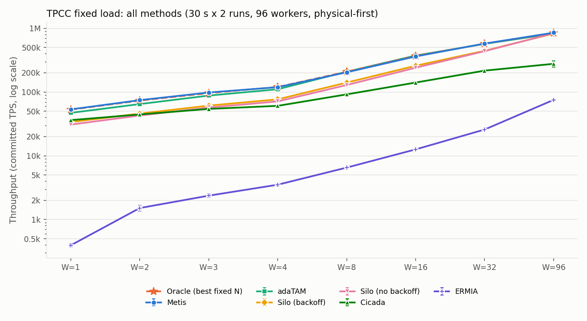
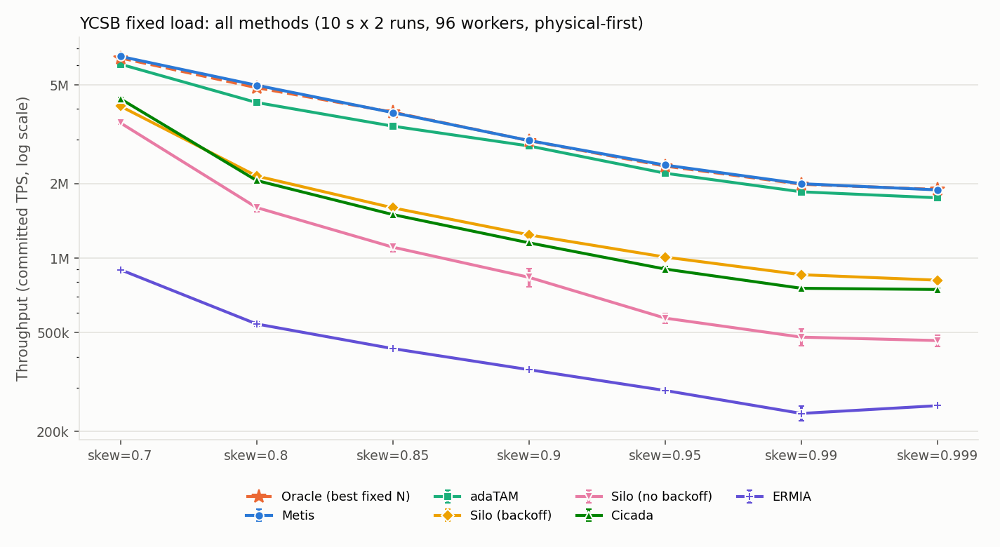

# Metis v2 ② 固定負荷での方式比較（2026-11-03）

## 結論

- **v2-A は両ベンチマークで最も oracle に近い**。TPS/oracle の幾何平均は TPC-C 0.994、YCSB 0.975。
- **v2-A の改善の倍率（幾何平均）**：

| 比較の相手 | TPC-C | YCSB |
|---|--:|--:|
| adaTAM | 1.05 倍（最大 1.14 倍） | 1.06 倍（最大 1.11 倍） |
| Silo（backoff あり） | 1.42 倍（最大 1.60 倍） | 2.16 倍（最大 2.35 倍） |
| Silo（backoff なし） | 1.50 倍（最大 1.72 倍） | 3.27 倍（最大 4.05 倍） |
| Cicada | 2.10 倍 | 2.30 倍 |

- **adaTAM との差**：TPC-C では W=1〜4 で v2-A が 7〜13% 高い。W=8・16 では adaTAM がわずかに高い（+1%、+4%）。W=16 で v2-A が SMT 側の 56〜58 を選ぶため（既知の問題）。YCSB ではすべての skew で v2-A が高い（+1〜11%）。
- **ERMIA は異常に低い**（TPC-C の W=1 で 394 TPS、YCSB でも Silo の 1/2〜1/4）。実装か設定の問題が疑われ、このまま論文に載せるのは危険。

## 条件

- **共通**：96 worker、CPU の配置は physical-first、mimalloc、`--clocks_per_us=2900`。2 run 目は方式の順を逆にした。
- **TPC-C**：標準ミックス、8 状態、30 秒 × 2 run。
- **YCSB**：10k tuple、10 操作、read 50%、7 skew、10 秒 × 2 run。
- **oracle**：固定 N の最高 TPS（[TPC-C ①](tpcc_01_conditions_and_oracle.md) の 8 状態、[YCSB ②](ycsb_02_oracle.md)）。別の時刻に測ったもの。
- **方式ごとの設定**：

| 方式 | 設定 |
|---|---|
| Metis v2-A | 評価する状態を除いて学習したモデル（[①](metis_v2_01_tpcc_loo.md)）。制御周期は TPC-C 200 ms、YCSB 10 ms |
| adaTAM | 96 から開始。制御周期は v2 と同じ。1 回に動かす幅は短い試し測定で最良のもの（TPC-C は 2/4/8 から 8、YCSB は 1/2/4/8 から 4） |
| Silo（backoff あり・なし） | 96 worker を常に全部動かす |
| Cicada、ERMIA | 96 worker。TPC-C は `--batch_th_num=0 --gc_inter_us=1e9 --gc_defer_record_reclamation=false`（以前の比較と同じ）。YCSB は既定の設定で、`CCBENCH_PIN_CPU_LIST` により physical-first と同じ順に pin |

- **adaTAM の公平さのための修正**：TPC-C で止めた worker が retry ループの中で走り続けないように、adaTAM の active 数も retry ループに伝えるようにした（[tam.hh](../include/tam.hh)、[tpcc.hh](../include/tpcc.hh)）。
- **Cicada の OOM**：TPC-C の W=96、2 run 目の最初の試行は、メモリ不足で OOM killer に止められた（GC を遅らせる設定で、1 run 目でも 139 GB 使用）。やり直しでは完走したので、その値を使った。

## TPC-C（30 秒、2 run の平均 TPS）

| W | oracle | **v2-A** | adaTAM | Silo（backoff なし） | Silo（backoff あり） | Cicada | ERMIA |
|--:|--:|--:|--:|--:|--:|--:|--:|
| 1 | 52,876 | **52,216** | 47,091 | 30,846 | 33,798 | 36,252 | 394 |
| 2 | 73,369 | **73,444** | 64,706 | 42,787 | 45,902 | 44,462 | 1,514 |
| 3 | 96,064 | **94,152** | 87,918 | 56,998 | 61,184 | 54,338 | 2,368 |
| 4 | 120,166 | **122,266** | 110,567 | 71,276 | 76,746 | 60,691 | 3,516 |
| 8 | 207,946 | 205,627 | **208,184** | 128,698 | 140,574 | 91,817 | 6,525 |
| 16 | 368,893 | 358,642 | **373,477** | 240,343 | 258,236 | 140,710 | 12,590 |
| 32 | 572,736 | **580,104** | 569,523 | 437,266 | 443,479 | 216,568 | 25,804 |
| 96 | 842,096 | **837,256** | 824,441 | 835,101 | 826,053 | 276,930 | 75,232 |
| oracle 比（幾何平均） | | **0.994** | 0.948 | 0.661 | 0.701 | 0.473 | 0.029 |

選んだ N（2 run それぞれで最も長くいた値）：

| W | 1 | 2 | 3 | 4 | 8 | 16 | 32 | 96 |
|---|---|---|---|---|---|---|---|---|
| v2-A | 12 / 14 | 10 / 18 | 28 / 14 | 20 / 20 | 58 / 44 | 56 / 58 | 52 / 50 | 48 / 48 |
| adaTAM | 80 / 9 | 80 / 72 | 72 / 72 | 72 / 72 | 40 / 40 | 48 / 48 | 48 / 48 | 96 / 48 |

adaTAM は低 W で、少なくとも 1 run で 72〜80 に留まり、最適値（6〜20）まで下がれなかった。

## YCSB（10 秒、2 run の平均 TPS）

| skew | oracle | **v2-A** | adaTAM | Silo（backoff なし） | Silo（backoff あり） | Cicada | ERMIA |
|--:|--:|--:|--:|--:|--:|--:|--:|
| 0.7 | 6,424,341 | **6,274,031** | 6,061,073 | 3,514,434 | 4,104,734 | 4,395,156 | 898,428 |
| 0.8 | 4,871,493 | **4,701,308** | 4,245,962 | 1,600,221 | 2,144,852 | 2,057,176 | 542,518 |
| 0.85 | 3,881,851 | **3,749,474** | 3,408,527 | 1,107,616 | 1,596,174 | 1,499,083 | 431,534 |
| 0.9 | 2,978,994 | **2,923,330** | 2,835,318 | 836,890 | 1,241,723 | 1,152,978 | 354,764 |
| 0.95 | 2,351,288 | **2,278,227** | 2,201,177 | 572,754 | 1,009,897 | 903,436 | 292,372 |
| 0.99 | 1,985,998 | **1,943,499** | 1,851,738 | 479,990 | 857,314 | 755,686 | 236,230 |
| 0.999 | 1,892,834 | **1,871,040** | 1,751,746 | 464,980 | 814,772 | 747,328 | 253,910 |
| oracle 比（幾何平均） | | **0.975** | 0.919 | 0.298 | 0.452 | 0.425 | 0.122 |

## 注意と次の作業

- **固定負荷では adaTAM との差は 5〜6% にとどまる**。v2-A の強みは、負荷が変わったときの追従の速さに出るはずなので、動的負荷（D1〜D4）での比較が要る。
- ERMIA の値が異常なので、原因を調べるか、論文の比較から外す。
- データ：[TPC-C の全 run](../experiments/ICDE/metis_v2/tpcc/compare_fixed/results.csv)、[YCSB の全 run](../experiments/ICDE/metis_v2/ycsb/compare_fixed/results.csv)。各フォルダの `summary.csv` と `config.txt`（バイナリの SHA-256 を含む）も参照。スクリプトは [compare.py](../experiments/ICDE/metis_v2/compare.py)、[plot_compare.py](../experiments/ICDE/metis_v2/plot_compare.py)。

## 追記：v2-A 最終版での測り直しと動的負荷（2026-11-03 昼）

v2-A に「探索中の負荷変化の検出」を足した（探索中に同じ N の値が大きくずれたとき、または移動の結果がモデルの予測と log で 0.4 以上食い違い、かつ実際の変化が log で 0.6 以上のときに、記憶を消して探索をやり直す。1 回の探索で 2 回まで）。v2-A だけを最終版のコードで測り直した。比較対象は前の測定のまま。以前の v2-A の値は `results_v2_before_final.csv` に残してある。

### 固定負荷（v2-A 最終版）

| | TPS/oracle の幾何平均 | adaTAM に対する倍率 | Silo（backoff あり）に対する倍率 |
|---|--:|--:|--:|
| TPC-C（30 秒 × 2 run） | 0.960（前回の版は 0.994） | 1.01 倍（0.94〜1.10） | 1.37 倍 |
| YCSB（10 秒 × 2 run） | 0.993（前回の版は 0.975） | 1.08 倍（1.04〜1.15） | 2.20 倍 |

- TPC-C で追加した検出は 1 回も働いておらず、探索の進み方は前回の版と同じ。差は確定の判断に使う 200 ms 1 区間の測定のばらつきによる（例：W=4 で N=44 が 1 区間だけ高く測れて確定、実力は最高の約 0.93 倍）。TPC-C は最高点の付近が平坦なので、数 % のばらつきで確定する N が入れ替わる。

### 動的負荷（60 秒 × 2 run、oracle 比）

| スケジュール | v2-A | adaTAM | Silo（backoff あり） | Silo（backoff なし） | v2-A / adaTAM |
|---|--:|--:|--:|--:|--:|
| D1：W 16→1→4 | 0.948 | 0.992 | 0.681 | 0.635 | 0.955 |
| D2：W 2→96→3 | 0.975 | 0.988 | 0.929 | 0.931 | 0.987 |
| D3：6 区間、各 10 秒 | 0.963 | 0.969 | 0.825 | 0.814 | 0.994 |
| D4_5s：W 1↔32 を 5 秒ごと | 0.890 | 0.936 | 0.767 | 0.752 | 0.950 |
| D4_2s：W 1↔32 を 2 秒ごと | 0.918 | 0.890 | 0.765 | 0.747 | 1.031 |
| Y1：skew 0.7→0.95→0.8 | 1.012 | 0.955 | 0.535 | 0.422 | 1.060 |
| Y2：skew 0.99→0.7→0.9 | 0.998 | 0.973 | 0.539 | 0.436 | 1.026 |

図：`experiments/ICDE/metis_v2/{tpcc,ycsb}/dynamic/*.png`（[plot_dynamic.py](../experiments/ICDE/metis_v2/plot_dynamic.py) で作成）。

## 追記：ERMIA が低い原因（2026-11-03）

1. **読み手のビットマップのバグ**：`readers_` が 64 ビット 1 語で、`1 << thid_`（32 ビットの int のシフト）でビットを立てていたため、32 を超える worker が別の worker のビットを共有していた。2 語（128 worker 分）に広げて修正した（[version.hh](../cc/ermia/include/version.hh)、[transaction.hh](../cc/ermia/include/transaction.hh)、[transaction.cc](../cc/ermia/transaction.cc)、[util.cc](../cc/ermia/util.cc)）。**ただし性能への影響はほぼなかった**（修正前後の差は ±3% 以内、[確認実験](../experiments/ICDE/ermia_diagnosis_20261103/results.csv)）。
2. **ERMIA はもともと遅い**：競合のない一様分布の YCSB でも、8 worker で Silo の 0.66 倍、96 worker で 0.31 倍。コミットのたびに全 worker 共通のカウンタを足す処理（`++Lsn`）と SSN の検証のコストが考えられる。
3. **TPC-C では GC を止めた設定のせいで、さらに低く出ていた**：

| W | GC 停止・10 秒 | GC 停止・30 秒 | 通常の GC（`gc_inter_us=10`） |
|--:|--:|--:|---|
| 96 | 234,051 TPS（77 GB） | 74,033 TPS（84 GB） | 起動直後にエラーで停止（`garbage_collection.cc` の 136 行目、`gcRecord`） |
| 16 | 39,594 TPS（52 GB） | 12,637 TPS（63 GB） | 同上 |

GC を止めると、run を 10 秒から 30 秒に延ばしただけで TPS が約 1/3 になる。通常の GC は TPC-C のレコードの回収でエラーになるので使えない。**TPC-C の ERMIA の値は、run の長さで大きく変わる設定上の値であり、方式の比較には使えない**。Cicada も同じく GC を止めて動かしており（30 秒で 139〜185 GB）、同じ問題を持つ可能性が高い。

## 追記：v2-A 確定版（上位 3 個の再測定を追加、2026-11-03 午後）

探索が終わって確定する前に、実測で TPS が高かった上位 3 個の N をもう一度ずつ測り、前回の値と平均してから確定する（`--metis_v2_recheck=3`）。比較対象は前の測定のまま。以前の v2-A の値は `results_v2_before_recheck.csv`。**論文にはこの版の値を使う。**

### 固定負荷

| | v2-A の oracle 比 | adaTAM 比 | Silo（backoff あり）比 | Silo（backoff なし）比 | Cicada 比 | ERMIA 比 |
|---|--:|--:|--:|--:|--:|--:|
| TPC-C（8 状態、30 秒 × 2 run） | **1.002** | 1.06 倍（0.97〜1.15） | 1.43 倍 | 1.52 倍 | 2.12 倍 | 34.8 倍 |
| YCSB（7 skew、10 秒 × 2 run） | **1.006** | 1.09 倍（1.05〜1.17） | 2.23 倍 | 3.38 倍 | 2.37 倍 | 8.2 倍 |

TPC-C の v2-A / adaTAM：W=1: 1.14、W=2: 1.15、W=3: 1.12、W=4: 1.08、W=8: 0.98、W=16: 0.97、W=32: 1.01、W=96: 1.03。YCSB はすべての skew で 1.05〜1.17。

### 動的負荷（60 秒 × 2 run の平均、oracle 比）

| スケジュール | v2-A | adaTAM | Silo（backoff あり） | Silo（backoff なし） | v2-A / adaTAM | 2 run とも v2-A が最良 |
|---|--:|--:|--:|--:|--:|:-:|
| D1：W 16→1→4 | **1.000** | 0.992 | 0.681 | 0.635 | 1.008 | ○ |
| D2：W 2→96→3 | **1.008** | 0.988 | 0.929 | 0.931 | 1.021 | ○ |
| D3：6 区間、各 10 秒 | **0.985** | 0.969 | 0.825 | 0.814 | 1.017 | ○ |
| D4_5s：W 1↔32 を 5 秒ごと | 0.782 | **0.936** | 0.767 | 0.752 | 0.835 | × |
| D4_2s：W 1↔32 を 2 秒ごと | **0.942** | 0.890 | 0.765 | 0.747 | 1.058 | ○ |
| Y1：skew 0.7→0.95→0.8 | **1.021** | 0.955 | 0.535 | 0.422 | 1.069 | ○ |
| Y2：skew 0.99→0.7→0.9 | **1.012** | 0.973 | 0.539 | 0.436 | 1.040 | ○ |

- D4_5s で負けた理由：TPC-C の探索と再測定に約 4.5 秒かかり、区間（5 秒）とほぼ同じ長さになる。W=32 の区間の大半を、W=1 に合わせた小さい N のまま探索に使ってしまう。短い実験（1 run）では 0.978 だったので、切り替えと探索の時刻の重なり方で結果が大きく変わる。
- 図：[TPC-C 固定負荷](../experiments/ICDE/metis_v2/tpcc/compare_fixed/tps_by_state.png)、[YCSB 固定負荷](../experiments/ICDE/metis_v2/ycsb/compare_fixed/tps_by_state.png)、動的負荷は `experiments/ICDE/metis_v2/{tpcc,ycsb}/dynamic/*.png`。
