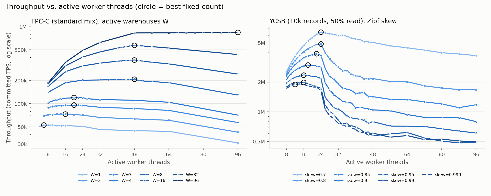
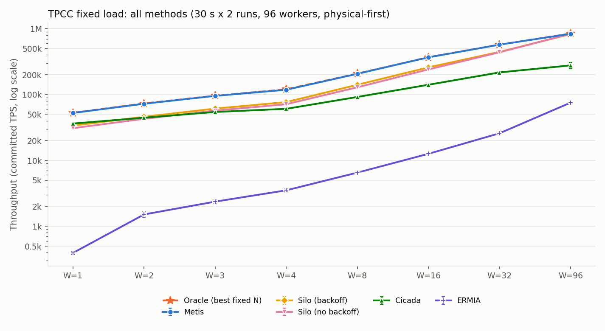
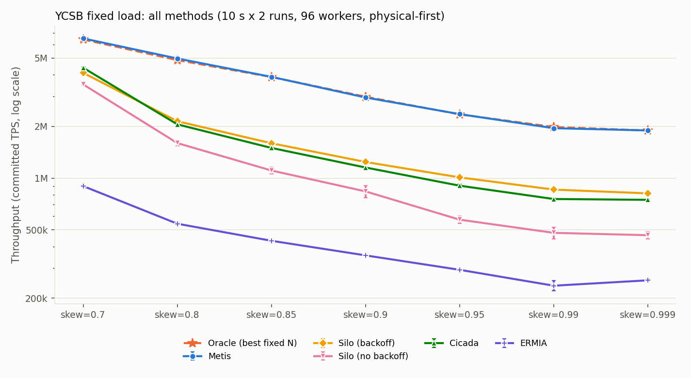
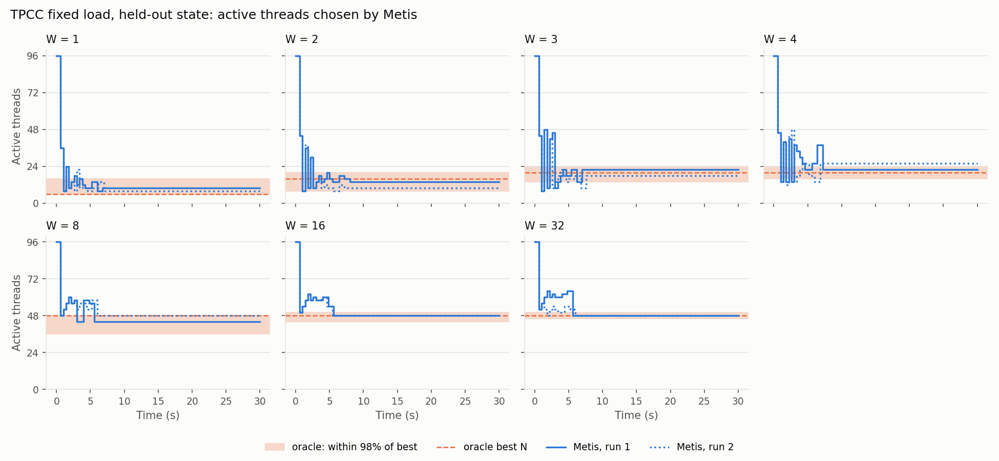
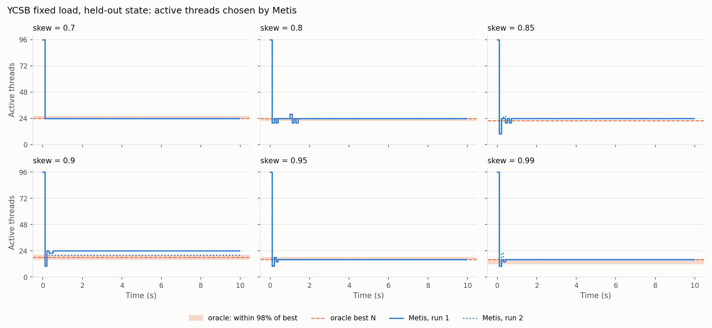
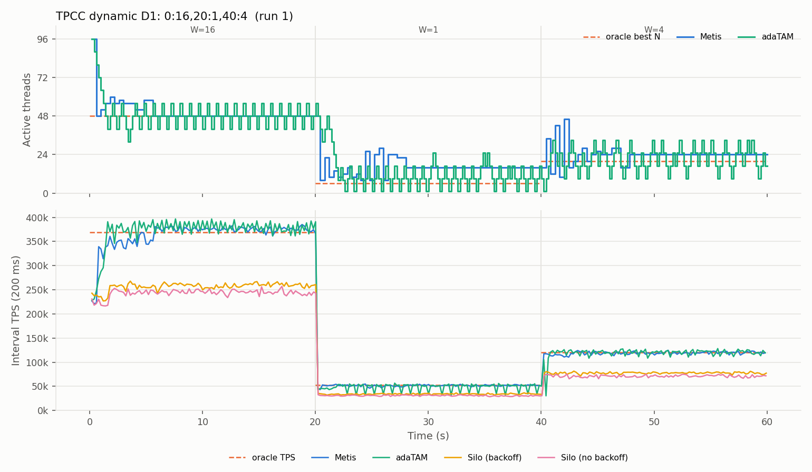
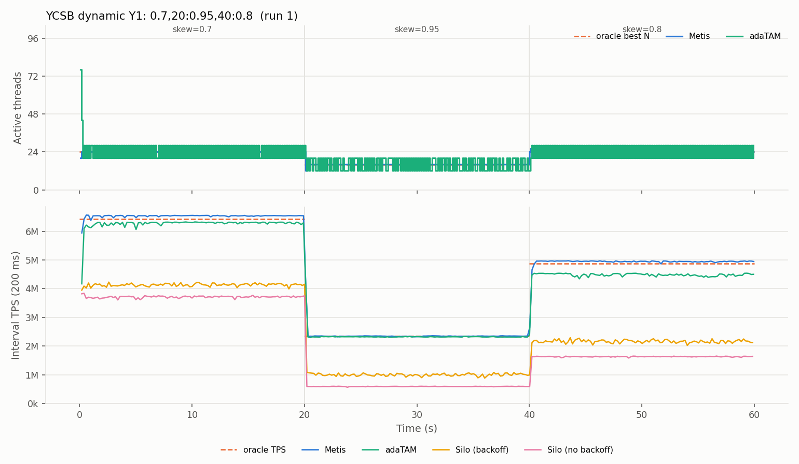
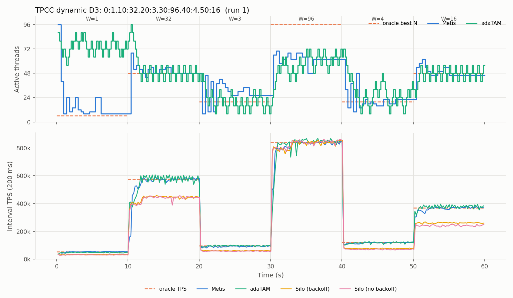

　　　# Metis full paper：載せる実験と図のまとめ（2026-11-03 確定版・版 RA）

論文に載せる予定の実験・図・表を 1 本にまとめたレポート。数値はすべて、Metis の確定版（版 RA）での測定値。確定版のコードは [include/metis_v2.hh](../include/metis_v2.hh) の既定値（`--metis_v2_recheck_intervals=3`、`--metis_v2_recheck_physical=true`）。版を選んだ経緯は節 9 を参照。

## 1. 論文のストーリー

**一言で**：最適な active thread 数は、ワークロードによって 6 から 96 まで大きく変わり、実行中にも変わる。Metis は、観測できる量だけから、学習していないワークロードでも最適に近い thread 数を数 trial で選び、その後は安定して保持する。

| 節 | 内容 |
|---|---|
| Introduction | 高競合では worker を増やすほど衝突と abort が増え、TPS が落ちる。最適な thread 数はワークロードで大きく変わり、実行中にも変わる。backoff は待ち時間を通じて間接的にしか並列度を下げられない。Metis は active thread 数の選択を contextual bandit として定式化し、観測量だけで選ぶ |
| Motivation | (1) 最適な thread 数が大きく変わる（図 1）。(2) 全 worker を動かすと大きく損をする。(3) 学習で解くときの難しさ：(a) TPS の大きさがワークロードで約 100 倍違う、(b) 未学習のワークロードへの汎化、(c) 測定のばらつきと平坦な最適値、(d) 探索中の負荷変化 |
| Design | (a)〜(d) への答えとして Metis を説明する（節 2） |
| Evaluation | 未学習の状態での固定負荷（節 4）、動的負荷（節 5）、追従の速さと安定性（節 6） |
| Related Work | backoff、thread activity management、学習を使った並行性制御、contextual bandit |
| Limitations | 節 8 |

- hill-climbing（adaTAM）は、Introduction と Motivation では触れない。Evaluation の比較対象としてだけ登場させる。
- CPU の配置は、physical-first で pin すると Setup に一文だけ書き、主張はしない。

## 2. Metis の構成（Design の節）

| 難しさ | Metis の設計 |
|---|---|
| (a) TPS の大きさの違い | 報酬は「移る前の TPS との比の対数」log(T(a)/T(c))。特徴は abort 率、thread 数の割合、使っている CPU 資源（物理コアのうち socket をまたぐ割合、SMT の割合。CPU トポロジから自動で読む）だけ。TPS の絶対値やワークロードの設定値（W、skew）は使わない |
| (b) 汎化 | 全候補（8〜96 の 2 刻み、45 個）で共有する 1 つの線形モデル：log(T(a)/T(c)) ≈ θᵀ[(φ(a)−φ(c)) ⊗ ψ(c)]。φ は thread 数の形（5 次元）、ψ は今の状態（1、R、R²、c/N）。オフラインで N をランダムに選んで集めたデータでリッジ回帰する。状態ごとの統計量は足し合わせられる |
| (c) ばらつきと平坦な最適値 | 予測で移る（最大 5 回）→ 実測で ±4・±2 を試す局所探索（最大 4 回）→ **確定する前に、実測で上位 3 個の N を 3 区間ずつ測り直す。最良の N が物理コア数（SMT の境目）を超えている場合は、物理コア数も候補に加える** → 最良の N に確定して保持 |
| (d) 負荷の変化 | 保持中：TPS または abort 率のずれが 2 区間続いたら探索をやり直す。探索中：同じ N の値が大きくずれたとき、または移動の結果がモデルの予測と大きく食い違ったときに、古い実測値を捨てて探索をやり直す |

- (c) の最後の段階の説明：最適値の付近では TPS の曲線が平坦なので、1 区間（TPC-C では 200 ms）の測定ではばらつきに負ける。そこで最終候補だけを長く測る。物理コア数は TPS 曲線の折れ目になりやすい（図 1 の TPC-C では W=8〜32 の曲線が 48 で頭打ちになる）ので、CPU トポロジから分かるこの境目も必ず比べる。
- active でない worker は 50µs ずつ sleep して待つ。TPC-C では retry の合間でも止める。
- 制御周期は TPC-C 200 ms、YCSB 10 ms。1 trial あたりの commit 数（約 1 万件）で決める。ベンチマークごとに変えるのはこの値だけ。

## 3. 実験環境（Setup の節）

| 項目 | 値 |
|---|---|
| マシン | Intel Xeon Platinum 8375C × 2 socket、48 物理コア・96 論理 CPU、185 GiB、Ubuntu 24.04（KVM ゲスト） |
| 実装 | CCBench の Silo を拡張。96 worker を作り、先頭 N 個を active にする。worker は physical-first で pin、mimalloc を使用 |
| TPC-C | 標準ミックス（New-Order 45、Payment 43、Order-Status・Delivery・Stock-Level 各 4）、96 warehouse、Item 100,000。競合の強さは active warehouse 数 W（取引の home を 1〜W から選ぶ）で変える。状態は W=1/2/3/4/8/16/32/96 |
| YCSB | 10,000 record、1 取引 10 操作、read 50%。状態は Zipf skew 0.7/0.8/0.85/0.9/0.95/0.99/0.999 |
| 学習 | 状態ごとに N をランダムに選びながら動かす（TPC-C 30 秒 × 2 run、YCSB 20 秒 × 2 run）。サンプル数は TPC-C 約 1,000、YCSB 約 12,000 |
| 評価 | 固定負荷では、評価する状態を除いて学習したモデル（leave-one-out）を使う。動的負荷では全状態で学習したモデルを使う。評価中は学習を止める |
| oracle | 各状態で N を固定して掃引したときの最高 TPS（10 秒 × 2 run）。TPC-C は最高点の付近を 2 刻みで測った |
| 比較対象 | adaTAM（調整済み：96 から開始、制御周期は Metis と同じ、1 回に動かす幅は試し測定で最良のもの。TPC-C は 8、YCSB は 4）、Silo（backoff あり・なし）、Cicada、ERMIA。Silo・Cicada・ERMIA は 96 worker を全部動かす |
| run の長さ | 固定負荷：TPC-C 30 秒、YCSB 10 秒。動的負荷：60 秒。どれも 2 run で、2 run 目は方式の順を逆にした |

## 4. 実験 1：未学習の状態での固定負荷

### 図

- **図 1（Motivation）**：TPS と active thread 数の関係。TPC-C 8 状態と YCSB 7 skew。丸印が最高 N。
  
- **図 2**：方式ごとの TPS（縦軸は対数目盛り。adaTAM は含めない）。
  
  
- **図 3**：Metis が選んだ thread 数の時間推移（学習していない状態）。TPC-C の W=96 と YCSB の skew 0.999 は載せない。
  
  

### 図の解釈

- **図 1**：固定 N の掃引（TPC-C 8 状態、YCSB 7 skew）で、最適な thread 数がワークロードによって 6〜96 と大きく変わり、外すと TPS が大きく落ちることを示している（全 worker を動かすと最高の 25〜76%）。
- **図 2（TPC-C・YCSB）**：固定負荷の方式比較で、Metis が学習していない状態でも oracle とほぼ重なり、全 worker を動かす方式（Silo、Cicada、ERMIA）を競合が強いほど大きく上回ることを示している。
- **図 3（TPC-C・YCSB）**：固定負荷での Metis の thread 数の推移で、数秒以内（YCSB 約 0.3 秒、TPC-C 2〜7 秒）に最適に近い N に確定し、その後は動かないことを示している。

### 表 1：TPC-C（30 秒 × 2 run の平均 TPS、太字は各状態の最高）

| W | oracle（最高 N） | Metis | adaTAM（調整済み） | Silo（backoff あり） | Silo（backoff なし） | Cicada | ERMIA |
|--:|--:|--:|--:|--:|--:|--:|--:|
| 1 | 52,876（6） | **52,504** | 47,091 | 33,798 | 30,846 | 36,252 | 394 |
| 2 | 73,369（16） | **72,412** | 64,706 | 45,902 | 42,787 | 44,462 | 1,514 |
| 3 | 96,064（20） | **95,324** | 87,918 | 61,184 | 56,998 | 54,338 | 2,368 |
| 4 | 120,166（20） | **118,060** | 110,567 | 76,746 | 71,276 | 60,691 | 3,516 |
| 8 | 207,946（48） | 206,181 | **208,184** | 140,574 | 128,698 | 91,817 | 6,525 |
| 16 | 368,893（48） | 366,462 | **373,477** | 258,236 | 240,343 | 140,710 | 12,590 |
| 32 | 572,736（48） | **570,856** | 569,523 | 443,479 | 437,266 | 216,568 | 25,804 |
| 96 | 842,096（96） | **836,344** | 824,441 | 826,053 | 835,101 | 276,930 | 75,232 |
| **oracle 比（幾何平均）** | | **0.991** | 0.948 | 0.701 | 0.661 | 0.473 | 0.029 |
| **Metis の倍率（幾何平均）** | | – | 1.05 倍 | 1.41 倍 | 1.50 倍 | 2.10 倍 | 34.4 倍 |

### 表 2：YCSB（10 秒 × 2 run の平均 TPS、太字は各状態の最高）

| skew | oracle（最高 N） | Metis | adaTAM（調整済み） | Silo（backoff あり） | Silo（backoff なし） | Cicada | ERMIA |
|--:|--:|--:|--:|--:|--:|--:|--:|
| 0.7 | 6,424,341（24） | **6,512,452** | 6,061,073 | 4,104,734 | 3,514,434 | 4,395,156 | 898,428 |
| 0.8 | 4,871,493（24） | **4,975,586** | 4,245,962 | 2,144,852 | 1,600,221 | 2,057,176 | 542,518 |
| 0.85 | 3,881,851（22） | **3,889,089** | 3,408,527 | 1,596,174 | 1,107,616 | 1,499,083 | 431,534 |
| 0.9 | 2,978,994（18） | **2,949,154** | 2,835,318 | 1,241,723 | 836,890 | 1,152,978 | 354,764 |
| 0.95 | 2,351,288（16） | **2,359,722** | 2,201,177 | 1,009,897 | 572,754 | 903,436 | 292,372 |
| 0.99 | 1,985,998（16） | **1,953,240** | 1,851,738 | 857,314 | 479,990 | 755,686 | 236,230 |
| 0.999 | 1,892,834（12） | **1,895,563** | 1,751,746 | 814,772 | 464,980 | 747,328 | 253,910 |
| **oracle 比（幾何平均）** | | **1.002** | 0.919 | 0.452 | 0.298 | 0.425 | 0.122 |
| **Metis の倍率（幾何平均）** | | – | 1.09 倍 | 2.22 倍 | 3.36 倍 | 2.36 倍 | 8.2 倍 |

### 表 3：Metis が確定した N と、その N の oracle の曲線上での TPS 比

oracle の掃引で得た曲線上で、確定した N（10 秒以降に最も長くいた N）の TPS が最高の何倍にあたるか。別の時刻に測った oracle との TPS の比と違い、時刻による変動の影響を受けない。

| TPC-C の W | 最高 N（98% 以内の範囲） | run 1 | run 2 |
|--:|---|---|---|
| 1 | 6（6〜16） | 10（0.998） | 8（1.000） |
| 2 | 16（8〜20） | 14（1.000） | 10（0.988） |
| 3 | 20（14〜24） | 22（0.997） | 18（0.994） |
| 4 | 20（16〜24） | 22（0.997） | 26（0.971） |
| 8 | 48（36〜48） | 44（0.993） | 48（1.000） |
| 16 | 48（44〜50） | 48（1.000） | 48（1.000） |
| 32 | 48（46〜50） | 48（1.000） | 48（1.000） |
| 96 | 96（48〜96） | 48（0.984） | 54（0.986） |

| YCSB の skew | 最高 N | run 1 | run 2 |
|--:|--:|---|---|
| 0.7 | 24 | 24（1.000） | 24（1.000） |
| 0.8 | 24 | 24（1.000） | 24（1.000） |
| 0.85 | 22 | 24（0.964） | 24（0.964） |
| 0.9 | 18 | 24（0.951） | 20（0.995） |
| 0.95 | 16 | 16（1.000） | 16（1.000） |
| 0.99 | 16 | 16（1.000） | 16（1.000） |
| 0.999 | 12 | 14（0.994） | 14（0.994） |

### 主張

- **学習していない状態でも、最適に近い N を選ぶ**：TPC-C の W=1〜32 では、確定した N はすべて曲線上で 0.97〜1.00 の位置にある。YCSB では 0.95〜1.00。
- **TPS は oracle 並み**：幾何平均で TPC-C 0.991、YCSB 1.002。
- **全 worker を動かす方式より大きく速い**：Silo（backoff あり）の 1.41 倍（TPC-C）・2.22 倍（YCSB）。競合の強い状態ほど差が大きい（最大 1.58 倍・2.44 倍）。
- 図 3 では、YCSB は約 0.3 秒、TPC-C は約 7 秒以内に確定し、その後は動かない。

## 5. 実験 2：動的負荷

### 載せるスケジュール

| 名前 | 内容 | 最高 N の推移 |
|---|---|---|
| D1 | TPC-C、W 16 → 1 → 4（各 20 秒） | 48 → 6 → 20 |
| D2 | TPC-C、W 2 → 96 → 3（各 20 秒） | 16 → 96 → 20 |
| D3 | TPC-C、W 1 → 32 → 3 → 96 → 4 → 16（各 10 秒） | 6 → 48 → 20 → 96 → 20 → 48 |
| Y1 | YCSB、skew 0.7 → 0.95 → 0.8（各 20 秒） | 24 → 16 → 24 |
| Y2 | YCSB、skew 0.99 → 0.7 → 0.9（各 20 秒） | 16 → 24 → 18 |

### 表 4：動的負荷（60 秒 × 2 run の平均 TPS、かっこ内は oracle 比）

oracle は、各区間でその区間の最高 TPS を出し続けたとした場合の時間平均（切り替え直後の過渡は無視）。

| スケジュール | oracle | Metis | adaTAM（調整済み） | Silo（backoff あり） | Silo（backoff なし） | Metis / adaTAM |
|---|--:|--:|--:|--:|--:|--:|
| D1 | 180,645 | 176,926（0.979） | 179,168（0.992） | 123,048（0.681） | 114,704（0.635） | 0.987 |
| D2 | 337,176 | 334,880（0.993） | 333,006（0.988） | 313,166（0.929） | 313,792（0.931） | 1.006 |
| D3 | 342,139 | 330,288（0.965） | 331,366（0.969） | 282,411（0.825） | 278,470（0.814） | 0.997 |
| Y1 | 4,549,040 | **4,620,596（1.016）** | 4,342,076（0.955） | 2,434,496（0.535） | 1,921,608（0.422） | **1.064** |
| Y2 | 3,796,444 | **3,826,469（1.008）** | 3,693,840（0.973） | 2,045,898（0.539） | 1,655,574（0.436） | **1.036** |

- Silo（backoff あり）に対しては、TPC-C で 1.07〜1.44 倍、YCSB で 1.87〜1.90 倍。
- adaTAM との TPS の差は、TPC-C では ±1.3% 以内で同等、YCSB では Metis が 3.6〜6.4% 高い。

### 図 4：時間ごとの thread 数（上）と 200 ms ごとの TPS（下）

- 本文に載せる候補：D1 と Y1（必要なら D3）。D2 と Y2 は付録へ。
  
  
  
- その他：[D2](../experiments/ICDE/metis_v2/paper_figures/dynamic_tpcc_D2.png)、[Y2](../experiments/ICDE/metis_v2/paper_figures/dynamic_ycsb_Y2.png)

### 図の解釈

- **D1**：TPC-C で W を 16→1→4 と変える実験で、競合が急に強くなる切り替え（W=16→1）でも、Metis が 1 手で最適値の近くへ移り（0.6 秒で oracle の 95%）、その後も安定することを示している。adaTAM は少しずつしか下げられず、振動を続けて最適値に届かない。
- **Y1**：YCSB で skew を 0.7→0.95→0.8 と変える実験で、Metis が全区間で 0.4 秒以内に最適な N に移って動かず、oracle 並みの TPS を保つことを示している。adaTAM は振動を続け、skew 0.8 の区間で最適値まで上がりきれない。
- **D3**（付録候補）：TPC-C で W を 10 秒ごとに大きく変える実験で、最高 N が大きく下がる区間（W=1、W=4）で Metis の追従が速いことを示している。W=3・32 の区間では adaTAM とほぼ同等。

## 6. 実験 3：追従の速さと安定性（adaTAM との比較）

### 表 5：最適値への到達時間と過渡の損失

- **到達時間**：負荷が変わってから、200 ms ごとの TPS が oracle の 95% に入り、その区間の最後まで平均して 95% 以上を保ち始めるまでの時間。全区間 × 2 run の中央値。
- **過渡の損失**：区間の平均 TPS が oracle に足りなかった割合（負の値は oracle を上回った）。

| スケジュール | Metis | adaTAM（調整済み） | Silo（backoff あり） |
|---|---|---|---|
| D1 | **1.0 秒**／**2.0%** | 2.0 秒／3.3% | 到達しない／33.8% |
| D2 | **0.7 秒**／**0.7%** | 8.0 秒／5.8% | 到達しない／24.9% |
| D3 | **1.4 秒**／**3.0%** | 1.6 秒／4.0% | 到達しない／27.3% |
| Y1 | **0.3 秒**／**−1.3%** | 0.6 秒／4.1% | 到達しない／49.5% |
| Y2 | 0.4 秒／**−0.3%** | 0.3 秒／2.7% | 到達しない／50.8% |

### 表 6：確定した後の安定性（固定負荷、5 秒以降）

| | Metis | adaTAM（調整済み） |
|---|--:|--:|
| TPC-C：1 秒あたりの thread 数の変更回数 | **0.18 回** | 9.74 回 |
| TPC-C：thread 数の標準偏差 | **1.4** | 8.6 |
| YCSB：1 秒あたりの thread 数の変更回数 | **0 回** | 4.22 回 |
| YCSB：thread 数の標準偏差 | **0** | 2.1 |

### 主張

- **TPC-C では、Metis が oracle の 95% に届くのが速い**：D1 で 2 倍、D2 で 11 倍。モデルの最初の 1〜2 手で最適値の近くに移るため。D3 ではほぼ同じ（1.4 秒 対 1.6 秒）。
- **過渡の損失は、5 スケジュールすべてで Metis が最小**。
- **確定した後はほとんど動かない**：TPC-C の変更回数は adaTAM の約 1/54。YCSB では変更なし。adaTAM は最適値の周りを、動かす幅ずつ振動し続ける（図 4 の緑の線）。
- 計算：[convergence.py](../experiments/ICDE/metis_v2/convergence.py)、区間ごとの値：`experiments/ICDE/metis_v2/{tpcc,ycsb}/dynamic/convergence_summary.csv`。

## 7. 注記として書くこと

- **Cicada と ERMIA の TPC-C**：GC を止めた設定（`gc_inter_us=1e9`）でしか動かない。通常の GC は、TPC-C のレコードの回収でエラーになる。ERMIA は run を 10 秒から 30 秒に延ばしただけで TPS が約 1/3 になり、Cicada は 30 秒で 139〜185 GB のメモリを使う。値は参考として載せ、この制約を注記する。
- **ERMIA がもともと遅いこと**：競合のない一様分布の YCSB でも、Silo の 0.31〜0.66 倍だった。読み手のビットマップの実装のバグ（32 を超える worker で別の worker のビットを共有）を見つけて修正したが、性能への影響はほぼなかった（±3% 以内）。
- **adaTAM は「調整済み」**：1 回に動かす幅を、ベンチマークごとに試し測定で選んだ（TPC-C は 2/4/8 から 8、YCSB は 1/2/4/8 から 4）。
- **oracle 比の読み方**：oracle は別の時刻に測ったので、TPS の oracle 比には ±2〜3% の変動が含まれる。選択の正しさは表 3 で示す。

## 8. Limitations

- **切り替えの間隔が短いと追従が遅れる**：TPC-C の探索と確定には数秒かかる。W を 5 秒ごとに 1↔32 と切り替えた条件では、adaTAM を下回った。本文には載せない。
- **学習には、代表的な状態での事前の測定が要る**。
- **評価は 1 台のマシン**（KVM ゲスト。CPU の性能カウンタは使えない）。
- **CPU の配置は physical-first に固定した**。配置の選択は今後の課題とする。

## 9. 版の選択の経緯（論文には書かない）

| 版 | 確定前の測り直し | TPC-C 固定負荷の oracle 比 | 確定した N の曲線上の位置（TPC-C の W=1〜32、2 run のうち悪い方の最小） |
|---|---|--:|--:|
| P | 上位 3 個を 1 区間ずつ | 1.002 | 0.926（W=8〜32 で 52〜60、SMT の側） |
| **RA（採用）** | **上位 3 個を 3 区間ずつ ＋ 物理コア数も比べる** | 0.991 | **0.971** |
| A | 上位 3 個を 1 区間ずつ ＋ 物理コア数も比べる | 0.987 | 0.922 |

- 3 つの版の TPS の差（1〜2%）は、同じ版を測り直したときの変動とほぼ同じ大きさ。
- 版 RA だけが、図 3 で「最適に近い N を選ぶ」という主張と一致するので採用した。
- 比較の図：[compare_P_RA.png](../experiments/ICDE/metis_v2/versions/compare_P_RA.png)。各版の結果は `results_v2_before_anchor.csv`（P）、`results_v2_anchor_recheck3.csv`（RA、今の `results.csv` と同じ）、`results_v2_anchor_only.csv`（A）。

## 10. 載せないもの

- ワークショップ版 Metis との比較、ablation。
- 調整しない adaTAM（幅 2）。TPS は調整済みとほぼ同じ（TPC-C 0.944、YCSB 0.897）。到達時間は調整済みより遅い（D1 で 6.6 秒、D2 では 20 秒以内に到達しない）。データは `results.csv` の `adatam_default`。
- D4（W 1↔32 の速い切り替え）。

## 11. 残りの作業

| 作業 | 時間の目安 |
|---|---|
| オーバーヘッドの測定：1 回の判断にかかる時間、制御器の CPU 使用量 | 約 1 時間 |
| 主要な表を 3〜5 run に増やすかの判断（増やすなら夜に回す） | マシン時間 1〜1.5 時間 |
| 図を論文用に整える（フォント、サイズ、段組み） | 執筆と並行 |

## 12. ファイルの場所

- **論文用の図**：[experiments/ICDE/metis_v2/paper_figures/](../experiments/ICDE/metis_v2/paper_figures)
- **生データ**：
  - 固定負荷：`experiments/ICDE/metis_v2/{tpcc,ycsb}/compare_fixed/results.csv`
  - 動的負荷：`experiments/ICDE/metis_v2/{tpcc,ycsb}/dynamic/results.csv`
  - oracle：[TPC-C](../experiments/ICDE/tpcc/metis_test/logs/fixed/standard_oracle_8states_20261103)、[YCSB](../experiments/ICDE/ycsb/oracle_physical_first_20261103/results.csv)
- **スクリプト**：
  - 学習・評価：[run.py](../experiments/ICDE/metis_v2/run.py)
  - 固定負荷の比較：[compare.py](../experiments/ICDE/metis_v2/compare.py)
  - 動的負荷：[dynamic.py](../experiments/ICDE/metis_v2/dynamic.py)
  - 作図：[plot_motivation.py](../experiments/ICDE/metis_v2/plot_motivation.py)、[plot_compare.py](../experiments/ICDE/metis_v2/plot_compare.py)（`--exclude adatam`）、[plot_fixed.py](../experiments/ICDE/metis_v2/plot_fixed.py)（`--source compare --exclude-states`）、[plot_dynamic.py](../experiments/ICDE/metis_v2/plot_dynamic.py)、[plot_versions.py](../experiments/ICDE/metis_v2/plot_versions.py)
  - 到達時間と安定性：[convergence.py](../experiments/ICDE/metis_v2/convergence.py)
