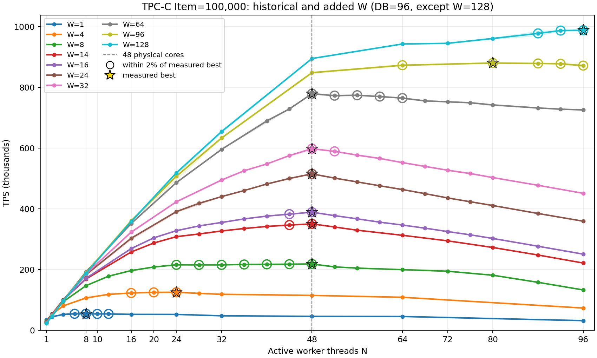
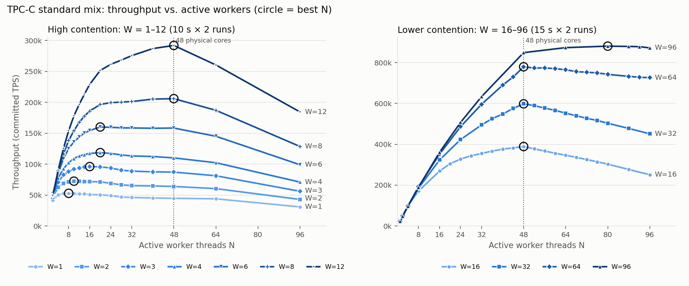

# TPC-C ① 実験条件と固定 N の性能曲線（oracle）

最終更新 2026-11-03。モデルを使わず、active worker 数 N を固定して測った結果だけをまとめる。モデルの結果は [② Metis モデル](tpcc_02_metis_models.md)、条件を決めるまでに見つけた問題は [③ 落とし穴](tpcc_03_pitfalls.md) を参照。

## 要点

- **現行の標準条件**（下表）での最高 N は、W=1/4/8/16/32/64/96 の順に **8 / 24 / 48 / 48 / 48 / 48 / 80**。
- 最高 N が散らばるのは **W=1〜8 の区間だけ**。W≧8 では性能の上限が競合ではなくハードウェア（物理コア 48 個と SMT の境界）で決まり、最高 N は 48 に張り付く。
- **N を間違えたときの損は大きい**。W≦32 で N=96 にすると、最高値の 58〜75% しか出ない。
- **取引ミックスを変えると、同じ W でも最高 N が変わる**（W=1：標準ミックス 8 → New-Order 60%/Payment 40% で 24。W=32：48 → 96）。状態集合の作り直しはこの性質を使う予定（2026-11-03 のパイロットを実行中）。

## 用語

| 用語 | 意味 |
|---|---|
| DB warehouse | `--tpcc_num_wh`。ロードする warehouse の数。remote 先もこの範囲から選ぶ |
| active W | `--tpcc_active_warehouse_count`。取引の home warehouse の候補を 1〜W に限る。DB の残りは削除しない |
| worker | 常に 96 個の thread を作る（`--thread_num=96`）。先頭 N 個だけが取引を実行し、残りは 50µs ごとに sleep して待つ |
| N | active worker 数。固定 N の実験では `--metis_test_fixed_threads=N` を指定する |

## 現行の標準条件（以降の TPC-C 実験の基準）

| 項目 | 値 |
|---|---|
| DB / worker | DB 96 warehouse、96 worker |
| Item | 100,000（TPC-C の仕様どおり） |
| 取引ミックス | New-Order 45 / Payment 43 / Order-Status 4 / Delivery 4 / Stock-Level 4、think time 0 |
| home の選び方 | 取引ごとに 1〜W から一様に選ぶ（`random_per_transaction`） |
| CPU 配置 | `--tpcc_pin_order=physical_first`：socket0 の物理コア → socket1 の物理コア → SMT sibling の順。N≦48 では SMT を使わない |
| allocator | mimalloc v2.3.2 を `LD_PRELOAD`（`build_release/mimalloc_override/libmimalloc.so`） |
| メモリ配置 | OS 既定（numactl は使わない） |
| 待機中の worker | 50µs sleep。epoch の quiescent 通知あり |
| 時間の換算 | `--clocks_per_us=2900`（実時間との一致を確認済み） |
| backoff | なし（Silo の BACK_OFF=0） |

## 固定 N の掃引：標準条件

各点は 15 秒 × 2 run の平均。各 W の最高 TPS を 1.00 として並べた。**太字**は最高値の 98% 以上。

| W | 最高 TPS | N=8 | 16 | 24 | 32 | 48 | 64 | 80 | 96 |
|--:|--:|--:|--:|--:|--:|--:|--:|--:|--:|
| 1 | 54,350 | **1.00** | 0.96 | 0.96 | 0.88 | 0.84 | 0.83 | – | 0.58 |
| 4 | 125,190 | 0.85 | **0.98** | **1.00** | 0.95 | 0.92 | 0.87 | – | 0.58 |
| 8 | 218,271 | 0.67 | 0.90 | **0.99** | **0.99** | **1.00** | 0.91 | 0.83 | 0.61 |
| 16 | 389,051 | 0.44 | 0.69 | 0.84 | 0.91 | **1.00** | 0.89 | 0.78 | 0.64 |
| 32 | 598,057 | 0.31 | 0.54 | 0.71 | 0.83 | **1.00** | 0.92 | 0.84 | 0.75 |
| 64 | 779,349 | 0.25 | 0.45 | 0.62 | 0.76 | **1.00** | **0.98** | 0.95 | 0.93 |
| 96 | 880,461 | 0.21 | 0.41 | 0.58 | 0.72 | 0.96 | **0.99** | **1.00** | **0.99** |

- データ：[全 10 W の集計](../experiments/ICDE/tpcc/metis_test/figures/mimalloc_physical_first_uniform_v1/all10/summary.csv)、[W 別の最高値](../experiments/ICDE/tpcc/metis_test/figures/mimalloc_physical_first_uniform_v1/all10/best_by_w.csv)。W=14/24/128 も含む。
- 現在のバイナリで代表点（W=1/4/16/32 の最高 N）を測り直した差は +0.2〜+0.9%。
- 掃引した N は W ごとに 13〜23 点で、1〜96 の全整数ではない。

## 条件を変えたときの最高 N（感度）

すべて固定 N で測った値で、モデルは使っていない。

| 変えた条件 | W=1 | W=4 | W=16 | W=32 | W=96 | 分かったこと |
|---|--:|--:|--:|--:|--:|---|
| 標準条件（上表） | 8 | 24 | 48 | 48 | 80 | 基準 |
| CPU 配置を socket0-first（旧） | 10 | 20 | 72 | 72 | – | N=48 で socket0 の SMT を使ってしまい、曲線に谷ができる（[③ #10](tpcc_03_pitfalls.md)） |
| 旧配置＋DB メモリを node0 に固定 | 8 | 24 | 24 | 72 | – | 改善は一律ではない（±1〜2%）ので、OS 既定に戻した |
| Item 10,000 | – | – | 48 | 48 | – | 最高 TPS は +2〜3% だけ |
| Item 1,000・標準ミックス | 6 | 24 | 48 | 48 | 48 | – |
| Item 1,000・New-Order 60/Payment 40 | 24 | 48 | 68（48〜96 が 2% 以内） | 96 | 96 | **ミックスで最高 N が大きく動く** |
| Item 1,000・New-Order 40/Payment 60 | 24 | 48 | 48（48〜80 が 2% 以内） | 88 | 96 | 同上 |

- データ：[Item 1k 標準](../experiments/ICDE/tpcc/metis_test/logs/fixed/mimalloc_physical_first_item1k_standard_v1)、[60/40](../experiments/ICDE/tpcc/metis_test/logs/fixed/mimalloc_physical_first_item1k_no60_p40_v1)、[40/60](../experiments/ICDE/tpcc/metis_test/logs/fixed/mimalloc_physical_first_item1k_no40_p60_v1)、[Item 10k](../experiments/ICDE/tpcc/metis_test/figures/mimalloc_physical_first_item10k_v1)、[node0 固定](../experiments/ICDE/tpcc/metis_test/figures/mimalloc_node0_uniform_v1)、[CPU 配置の A/B](../experiments/ICDE/tpcc/metis_test/figures/mimalloc_pinning_order_ab_v1)。
- Item 1k の 2 種類のミックスは Order-Status/Delivery/Stock-Level を 0% にした派生ワークロードで、TPC-C の仕様からは外れる。

## 商品 ID の Zipf 化（2026-11-03）

New-Order の商品を Zipf(θ) で選ぶモードを追加し（`--tpcc_item_zipf_enable`、同じ注文の中では商品を重複させない）、W=1 で測った。

| ワークロード | θ=0 → 0.95 の変化 |
|---|---|
| 標準ミックス、DB=1、N=8 | TPS は −2%。最高 N はどの θ でも 6〜12 で、動かない |
| New-Order のみ、DB=16・W=1、N=8 | TPS は −42%（329k → 190k）。ただし最高 N は両 θ とも 20〜24 |
| New-Order のみ、W=8、N=48 | TPS は −36% |

- **結論**：商品の偏りは TPS を下げるが、最高 N はほとんど動かない。W=1 では Warehouse・District 行の更新が律速しているため。「状態ごとに最高 N が違う」軸としては弱い。
- 図：[標準ミックス W=1](../experiments/ICDE/tpcc/item_zipf_unique_w1_20261103/standard_w1_total_tps_vs_threads.png)、[New-Order のみ W=1](../experiments/ICDE/tpcc/item_zipf_unique_w1_20261103/neworder_w1_threads_vs_tps.png)。
- 実装：[tpcc_item_zipf.hh](../include/tpcc/tpcc_item_zipf.hh)、[tpcc_query.hh](../include/tpcc/tpcc_query.hh)。データ：[item_zipf_unique_w1_20261103/](../experiments/ICDE/tpcc/item_zipf_unique_w1_20261103)。

## 状態空間のパイロット（2026-11-03）

最高 N が状態ごとに散らばる状態集合を探した。Item 100k、標準条件、10 秒。[スクリプト](../experiments/ICDE/tpcc/metis_test/contention_space_pilot_20261103.sh)。

- **A**：標準ミックス、W=1〜12 × N 16 点 × 2 run。[結果](../experiments/ICDE/tpcc/metis_test/logs/fixed/contention_space_pilot_20261103/standard_lowW/results.csv)
- **B**：New-Order 60 / Payment 40（他の 3 種類は 0%）、W=1〜96 × N 13 点 × 1 run。[結果](../experiments/ICDE/tpcc/metis_test/logs/fixed/contention_space_pilot_20261103/no60_p40/results.csv)

| ミックス | W | 最高 N | 最高 TPS | 98% 以内の N | N=8 | N=16 | N=24 | N=48 | N=96 |
|---|--:|--:|--:|---|--:|--:|--:|--:|--:|
| 標準 | 1 | 8 | 52,830 | 6〜14 | **1.00** | 0.96 | 0.93 | 0.85 | 0.59 |
| 標準 | 2 | 10 | 72,526 | 10〜20 | 0.98 | 0.99 | 0.95 | 0.88 | 0.59 |
| 標準 | 3 | 16 | 96,089 | 14〜20 | 0.92 | **1.00** | 0.98 | 0.91 | 0.58 |
| 標準 | 4 | 20 | 118,674 | 16〜24 | 0.86 | 0.99 | 0.99 | 0.93 | 0.60 |
| 標準 | 6 | 20 | 160,100 | 20〜48（平坦） | 0.78 | 0.96 | **1.00** | 0.99 | 0.62 |
| 標準 | 8 | 48 | 205,938 | 40〜48 | 0.67 | 0.90 | 0.97 | **1.00** | 0.62 |
| 標準 | 12 | 48 | 291,977 | 40〜48 | 0.53 | 0.78 | 0.90 | **1.00** | 0.63 |
| NO60/P40 | 1 | 16 | 209,403 | 16〜20 | 0.89 | **1.00** | 0.97 | 0.89 | 0.67 |
| NO60/P40 | 2 | 24 | 345,654 | 24、40 | 0.70 | 0.93 | **1.00** | 0.97 | 0.73 |
| NO60/P40 | 4 | 48 | 583,352 | 48 | 0.54 | 0.76 | 0.89 | **1.00** | 0.79 |
| NO60/P40 | 8 | 48 | 896,788 | 48〜56 | 0.41 | 0.64 | 0.78 | **1.00** | 0.92 |
| NO60/P40 | 16 | 80 | 1,276,101 | 56〜96 | 0.32 | 0.54 | 0.70 | 0.97 | **1.00** |
| NO60/P40 | 32 | 96 | 1,782,178 | 96 | 0.23 | 0.43 | 0.58 | 0.89 | **1.00** |
| NO60/P40 | 96 | 96 | 2,545,941 | 96 | 0.15 | 0.32 | 0.45 | 0.78 | **1.00** |

標準ミックスの W 別の TPS 曲線（丸印がその W の最高 N）。左は今回のパイロット（W=1〜12、10 秒 × 2 run）、右は上の標準条件の掃引（W=16〜96、15 秒 × 2 run）で、測った時期が違うので縦軸を分けた。作図は [plot_standard_mix_tps_by_w.py](../experiments/ICDE/tpcc/metis_test/plot_standard_mix_tps_by_w.py)。

- 2 つのミックスを合わせると、最高 N は **8 / 10 / 16 / 20 / 24 / 48 / 80 / 96** と散らばる。標準ミックスの W=1〜4 は、2 run の差が最高点で 1.4% 以下だった。
- **同じ W でも、ミックスによって最高 N が変わる**：W=1 では 8 と 16、W=4 では 20 と 48、W=16〜32 では 48 と 80〜96。W から N を表引きするだけでは決まらない。
- 平坦で状態として使いにくいもの：標準ミックスの W=6（20〜48）と、NO60/P40 の W=16（56〜96）。
- NO60/P40 は 1 run だけなので、使う状態は測り直す必要がある。

### N=96 で測った abort 率だけでは、最高 N を決められない

| 状態 | 最高 N | N=96 の abort 率 | T(48)/T(96) |
|---|--:|--:|--:|
| 標準 W=1 | 8 | 0.910 | 1.45 |
| 標準 W=4 | 20 | 0.786 | 1.55 |
| 標準 W=12 | 48 | 0.588 | 1.58 |
| NO60/P40 W=1 | 16 | 0.997 | 1.33 |
| NO60/P40 W=4 | 48 | 0.985 | 1.27 |
| NO60/P40 W=16 | 80 | 0.818 | 0.97 |
| NO60/P40 W=32 | 96 | 0.633 | 0.89 |

- abort 率が近くても、最高 N が大きく違う組がある：標準 W=12（0.588 → 48）と NO60/P40 W=32（0.633 → 96）、標準 W=4（0.786 → 20）と NO60/P40 W=16（0.818 → 80）。
- ミックスが違うと、abort 率の高さと最高 N の関係が逆向きになる。NO60/P40 は abort 率が 0.99 前後と高いのに、最高 N は標準ミックスより大きい。
- N=48 と N=96 の TPS の比 T(48)/T(96) を併せて見ると区別できる。標準ミックスでは 1.45〜1.60、NO60/P40 では 0.78〜1.33。
- **v2 への示唆**：abort 率だけを見る方策（旧 observed-load の `k/a`）は、ミックスが変わると選択を誤る。特徴量には、N を変えたときの TPS の伸び方（スケーリングの指標）が要る。

## 未完了の測定

- **L3 キャッシュミス**：この KVM ゲストには CPU の PMU（性能カウンタ）が公開されておらず、測れない。測定用の [スクリプト](../experiments/ICDE/tpcc/metis_test/measure_llc_misses_item100k_smt.sh) は用意済みで、bare-metal のマシンなら実行できる。
