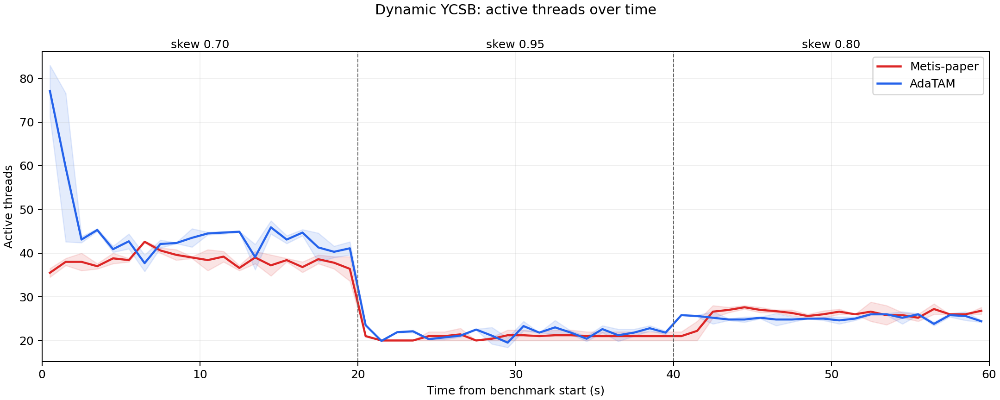
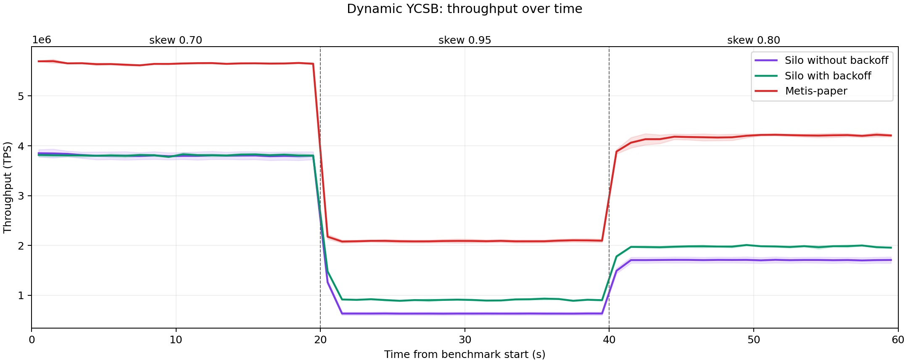

# YCSB動的ワークロード: Metis-paperとSiloの比較（2026-10-28）

## 条件

- 96 workerスレッド、60秒/run、2 run/方式。実行順は1巡目と2巡目で逆順にした。
- Zipf skewは`0.70 (0–20秒) → 0.95 (20–40秒) → 0.80 (40–60秒)`。10,000 tuple、最大10操作、read ratio 50%。
- 全方式で`numactl --membind=0`、`--pin_threads=true`、`--clocks_per_us=2900`、200 msごとのTPS記録を使用。TSC設定はこのホストで60秒の実行が約60秒と記録されることを確認した。
- Metis-paperは`models/model_test/linucb_all.txt`を読み込み、学習結果の自動保存を無効にした。Metis-paperの制御周期は10 ms、AdaTAMは1 ms。両方式のactive thread数は200 msごとに記録した。
- 現行ソースから`ycsb_metis_paper`、`silo_without_backoff`、`silo_with_backoff`を再ビルドした。

## 全60秒のTPS

| 方式 | run 1 | run 2 | 平均 |
|---|---:|---:|---:|
| silo_without_backoff | 1,993,308 | 2,104,154 | 2,048,731 |
| silo_with_backoff | 2,247,748 | 2,216,989 | 2,232,369 |
| Metis-paper | 3,943,971 | 4,000,232 | 3,972,102 |
| AdaTAM | 3,971,783 | 3,990,453 | 3,981,118 |

Metis-paperはSilo with backoffより平均77.9%、Silo without backoffより93.9%高かった。AdaTAMとの差は平均-0.23%で、この2 runから両者の優劣は判断しない。

## 時系列

折れ線は各方式2 runの1秒ごとの平均、薄い帯は2 runの最小～最大。破線はskewの切替時刻。元の200 ms標本を1秒ごとに平均した。[全runのTPSとabort率](../experiments/ICDE/ycsb/dynamic_comparison_20261028_034852/results.csv)、[TPS時系列CSV](../experiments/ICDE/ycsb/dynamic_comparison_20261028_034852/tps_timeseries.csv)、[active thread時系列CSV](../experiments/ICDE/ycsb/dynamic_comparison_20261028_034852/active_threads_timeseries.csv)を保存した。

再実行: `bash experiments/ICDE/ycsb/compare_dynamic_methods.sh`。作図: `python3 experiments/ICDE/ycsb/plot_dynamic_methods.py <結果ディレクトリ>`。
