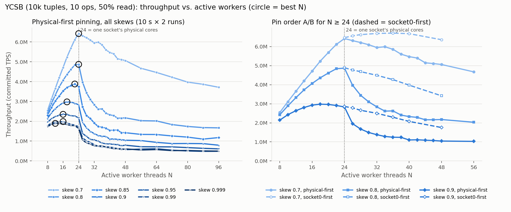

# YCSB ② 固定 N の性能曲線（oracle）と CPU 配置の A/B

測定 2026-11-03。TPC-C と条件をそろえ、active worker 数 N を固定して測った。モデルは使っていない。

## 要点

- physical-first の配置での最高 N は、skew 0.7/0.8/0.85/0.9/0.95/0.99/0.999 の順に **24 / 24 / 22 / 18 / 16 / 16 / 12**。最高点は鋭く、最高値の 98% 以内に入る N は 1〜3 点だけ。skew 0.8〜0.95 はワークショップ版の値（24/22/18/16）と一致した。
- **YCSB は socket をまたぐと大きく損をする**。physical-first では N が 24 を超えると 2 つ目の socket を使い始め、TPS が急に落ちる（N=26 で skew 0.8 は −18%、0.9 は −34%）。
- **socket0-first（同じ socket の SMT を先に使う）にすると、N>24 で +4〜89% 高い**。skew 0.7 の最高は N=36 の 6.71M TPS になり、physical-first の最高（N=24 の 6.42M）を 4.4% 上回る。skew 0.8 以上は最高 N が 24 以下で、両方の配置が同じ CPU を使うので、最高値は変わらない。
- **TPC-C とは逆の結果**。TPC-C は SMT を避ける physical-first の方が良い（N=48 で +47〜63%、[TPC-C ③ #10](tpcc_03_pitfalls.md)）。worker の配置順は、ベンチマークごとに決める設定値として扱う必要がある。

## 条件

| 項目 | 値 |
|---|---|
| ワークロード | 10,000 tuple、1 取引 10 操作、read 50%、Zipf skew は 0.7〜0.999 |
| worker | 96 個作り、先頭 N 個だけ動かす（adaTAM を min=max=N に固定）。残りは 50µs sleep |
| CPU 配置 | `--ycsb_pin_order=physical_first`（今回追加したフラグ） |
| その他 | mimalloc を `LD_PRELOAD`、NUMA は OS 既定、`--clocks_per_us=2900`、backoff なし |
| N の候補 | 8〜48 を 2 刻み、56〜96 を 8 刻み（27 点） |
| 測定時間 | 10 秒 × 2 run。2 run 目は逆順 |

## 結果（physical-first）

| skew | 最高 N | 最高 TPS | 98% 以内の N | 2 run の差 | N=48 / 最高 | N=96 / 最高 | N=96 の abort 率 | ワークショップ版の最高 N |
|--:|--:|--:|---|--:|--:|--:|--:|--:|
| 0.7 | 24 | 6,424,341 | 24〜26 | 0.2% | 0.79 | 0.58 | 0.803 | – |
| 0.8 | 24 | 4,871,493 | 22〜24 | 3.2% | 0.45 | 0.34 | 0.902 | 24 |
| 0.85 | 22 | 3,881,851 | 22 | 0.5% | 0.37 | 0.30 | 0.927 | 22 |
| 0.9 | 18 | 2,978,994 | 16〜20 | 0.6% | 0.35 | 0.27 | 0.949 | 18 |
| 0.95 | 16 | 2,351,288 | 16〜18 | 0.1% | 0.34 | 0.26 | 0.961 | 16 |
| 0.99 | 16 | 1,985,998 | 12〜16 | 0.3% | 0.29 | 0.25 | 0.967 | 14 |
| 0.999 | 12 | 1,892,834 | 12〜16 | 1.6% | 0.32 | 0.26 | 0.968 | – |

## CPU 配置の A/B（N≧24、同じバイナリ）

| skew | N=24 | 26 | 28 | 32 | 36 | 40 | 48 |
|--:|--:|--:|--:|--:|--:|--:|--:|
| 0.7 | +0.7% | +4.0% | +6.7% | +12.4% | +14.5% | +22.0% | +25.7% |
| 0.8 | +0.4% | +20.0% | +36.1% | +58.3% | +62.6% | +70.9% | +57.3% |
| 0.9 | +0.9% | +42.4% | +58.8% | +81.5% | +84.2% | +88.5% | +68.0% |

値は socket0-first の physical-first に対する差。N=24 では両方の配置が socket0 の物理コア 24 個を使うので、差は誤差の範囲（±1%）。

## 論文への示唆

- ワークショップ版の「socket-aware な配置」の主張は、YCSB では今回のデータでも裏付けられた。
- 同じ規則は TPC-C には当てはまらない。TPC-C では socket をまたぐ損より SMT を共有する損の方が大きい。
- 配置順は、ベンチマークごとの設定値（YCSB は socket0-first、TPC-C は physical-first）として固定するのが簡単。配置順も action として学習させる案は、余裕があれば検討する。
- **YCSB の oracle は socket0-first で取り直す必要がある**。skew 0.8 以上は最高 N≦24 なので今回の値をそのまま使えるが、skew 0.7 は N=24〜48 を socket0-first で測り直す。

## データと再実行

- [physical-first の全結果](../experiments/ICDE/ycsb/oracle_physical_first_20261103/results.csv)、[設定とバイナリの SHA-256](../experiments/ICDE/ycsb/oracle_physical_first_20261103/config.txt)
- [配置の A/B](../experiments/ICDE/ycsb/oracle_socket0_first_ab_20261103/results.csv)
- 測定スクリプト [oracle_sweep.sh](../experiments/ICDE/ycsb/oracle_sweep.sh)（`PIN_ORDER`、`SKEWS`、`THREADS`、`OUT` で条件を指定。同じ出力先なら途中から再開できる）。作図 [plot_oracle.py](../experiments/ICDE/ycsb/plot_oracle.py)
